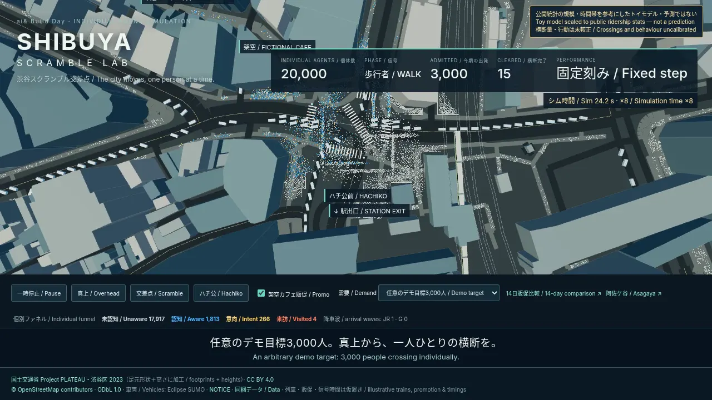

# Shibuya Scramble Lab

[日本語](README.md) · English · [Demo entry after publishing](https://haginot.github.io/asagaya-town-sim/)

**公開統計の規模・時間帯を参考にしたトイモデル・予測ではない / Toy model scaled to public ridership stats — not a prediction**

Change hypothetical demand and promotion settings to observe crowd clearance and visit-state changes. **Crossing volumes and behaviour remain uncalibrated.**

A metre-scale Shibuya crossing, Hachiko square and Yamanote/Ginza arrival waves, with 20,000 individual agents by default. Every person has a position, velocity, random stream and awareness → intent → visit funnel. A spatial grid, social forces, a Web Worker, GPU point billboards and vehicle InstancedMesh handle computation and drawing. This is an individual-agent simulation. The Shibuya runtime calls no LLM or external API.

Buildings use 1,050 PLATEAU ground footprints and heights; OSM supplies roads, railways and mapped shop objects. Vehicles replay trajectories generated with SUMO on the OSM network. LOD2 roofs/textures, terrain, real OD, controller timings, train schedules and promotion effects remain approximate or uncalibrated.

[Watch the video (separate 42 s MP4)](docs/media/index.html) · [Overhead crossing](docs/media/crossing.webp) · [14-day promotion results](docs/media/promo.webp) · [Try in a browser](https://haginot.github.io/asagaya-town-sim/) · [Run locally](#run)



Codex CLI implements the simulation, UI, recording tools and regression tests. The human role is review and verification of the evidence/assumption labels, attribution and pedestrian/vehicle release checks. Runtime agents follow numerical rules.

## Run

Python 3.9+, no Python runtime dependencies. Bundled JSON and three.js allow offline 3D after installation. Acquisition and initial package installation need network access.

```bash
uv run asagaya-town-sim serve --no-llm --no-open
# http://127.0.0.1:8765/ → web3d/shibuya/
uv run asagaya-town-sim build --area shibuya --no-llm -o out
uv run asagaya-town-sim demo --area shibuya --json --no-llm
uv run asagaya-town-sim serve --area shibuya --agents 30000 --normal-demand --hour 8 --no-open
```

`shibuya` is the new default for ordinary CLI, promotion CLI and Pages. `--agents` accepts 0–60,000; `--seed` selects individual random streams; `--hour` holds demand at a chosen hour in [0,24). Default: 15:00, upper-demand preset. CLI JSON exports configuration and requested demand; actual physical crossings run in the browser. The displayed population is not an observed simultaneous census.

When the `shibuya` revision is available from the repository, use the following commands. Wheels include map data; NOTICE specifies the separate data licenses.

```bash
uvx --from 'git+https://github.com/haginot/asagaya-town-sim.git@shibuya' asagaya-town-sim serve --area shibuya --no-llm --no-open
uvx --from 'git+https://github.com/haginot/asagaya-town-sim.git@shibuya' asagaya-town-sim promo demo --area shibuya --serve --no-open
```

## Read the scene

Choose overhead, scramble or Hachiko cameras, and upper-demand / station-scale / 08:00 presets. Admitted counts assigned departures; cleared counts people who reached the other side. If pedestrians overrun clearance, the shared traffic clock holds SUMO vehicles red. The 20,000 include background pedestrians, queues and arrival waves; they do not all cross in one phase.

White, blue, yellow and orange encode unaware, aware, intent and visited. The promotion switch changes exposure within the current run; it does not estimate a causal effect. Train waves reassign existing identities at the station exit, preserving total population. Their timing, size, exit distribution and the symbolic Hachiko sculpture are authored approximations.

`?record=1&cam=top` enables manual deterministic stepping. `window.__shibuyaState` exposes agent count, FPS, simulation time, draw calls, signal and funnel. Encoded video FPS differs from interactive FPS; see [performance](docs/PERFORMANCE.md).

## Evidence and assumptions

FY2024 daily averages: [JR East](https://www.jreast.co.jp/press/2025/20250912_ho03.pdf) 324,414 **boardings**; [Metro Ginza](https://www.tokyometro.jp/corporate/enterprise/passenger_rail/transportation/passengers/2024.html) 191,505 entries/exits; [Tokyu](https://www.tokyu.co.jp/railway/company/business/passengers/2024/) Toyoko 414,186 and Den-en-toshi 604,246; [Keio](https://www.keio.co.jp/company/corporate/corporate_manual/number-of-passengers.html) 286,940.

Assuming balanced JR exits produces a scale proxy of 2,145,705 station events, still including transfer/daily-return overlap. An assumed 12% street capture gives a 257,484.6 trips/day reference. Our approximate hourly shape follows published Shibuya City timing constraints: rise around 07:00, peak 14:00–16:00, faster decline after 19:00. It is not a quantitative fit to observed hourly crossing counts. Normalising this curve gives about 789 requested departures per 150 s phase at 15:00.

The separate 3,000-person peak preset multiplies that curve by 3.803. It is an arbitrary demonstration target, not a verified current official count. Full formulas, source URLs, limitations, neighbour truncation and uncalibrated values: [CALIBRATION.md](docs/CALIBRATION.md).

## Shibuya promotion comparison

```bash
uv run asagaya-town-sim promo demo --serve --no-open --port 8765
uv run asagaya-town-sim promo build --area shibuya -o out-promo
```

Open `http://127.0.0.1:8765/promo/?area=shibuya`. Real mapped shops supply context; the promotion target is **fictional Hidamari Coffee** near the crossing. OSM contains 111 mapped shop/food objects within 150 m, including 36 restaurants and 13 cafes. This is an incomplete mapped-object inventory, with possible node/area duplicates, rather than a census of operating businesses.

The existing 14-day experiment uses 400 fictional agents × scale 5 and 8 seeds, paired identities/random draws across no-promotion, ads, coupons and other combinations. Live frames use seed 0; ending metrics show means and 95% seed intervals. Its movement is schematic and separate from the physical crowd. All conversion, cost, sales and demand-time coefficients remain placeholders. More visits may not recover campaign costs. JSON overrides: `--config FILE`.

## Recording, regeneration and checks

```bash
bash tools/record_shibuya.sh
# /workspace/demos/shibuya-scramble.mp4
# /workspace/demos/shibuya-scramble/*.png and recording.json
uv run python tools/build_pages.py --out _site
python3 -m http.server --directory _site
```

The video is 42 s (30 s scene + 12 s credits), 1280×720, 30 fps; simulation time runs at ×8, with an overhead simultaneous-crossing opening for the first three seconds. Bilingual captions have a dedicated band separate from numeric rows. Requires Playwright Chromium and ffmpeg; unavailable headless WebGL falls back to DISPLAY/Xvfb. Override outputs with `SHIBUYA_VIDEO` / `SHIBUYA_STILLS`. 

```bash
uv run python tools/fetch_shibuya.py --cache /tmp/shibuya-source
uv run --with eclipse-sumo --with traci --with sumolib python tools/export_shibuya_traffic.py
uv run python tools/export_shibuya.py
# Node.js 20+
uv pip install -e . pytest
uv run pytest -q
node web3d/shibuya/verify.mjs
node --experimental-vm-modules web3d/sol/verify.mjs
node --experimental-vm-modules web3d/astra/check.mjs
node --experimental-vm-modules web3d/promo/verify.mjs
uv run python tools/update_readme_tables.py --check
```

Bilingual five-minute ai& Build Day talk: [presentation.md](docs/presentation.md).

## Data and licenses

Code and three.js: MIT. Buildings: modified MLIT Project PLATEAU / Shibuya City 2023 CityGML v4, reduced to ground exterior footprints plus heights. The [dataset](https://www.geospatial.jp/ckan/dataset/plateau-13113-shibuya-ku-2023) specifies [PLATEAU Site Policy](https://www.mlit.go.jp/plateau/site-policy/), whose explicit CC BY 4.0 permission was checked before use. Roads, railways, shop objects and derived vehicle trajectories: © OpenStreetMap contributors / ODbL 1.0. OSM was acquired 2026-10-21; query, bbox and checksums are bundled. Full extent: 1,102 mapped shop/food objects. Source databases are separate and exports include the derived datasets. The promo adapter `buildings_shibuya.json` contains `buildings` under CC BY 4.0 and `rails` under ODbL 1.0, explicitly licensed per component.

SUMO 1.28.0 was actually used during generation (EPL-2.0); the viewer needs no SUMO installation and is not a live TraCI co-simulation. Railway statistics are attributed factual values, without claiming a blanket open license for their websites. Screenshots/video retain on-screen credits. Details: [NOTICE](NOTICE).

## Existing Asagaya compatibility mode

`uv run asagaya-town-sim serve --area asagaya --no-llm --no-open`; promotion: `promo demo --area asagaya`. Its legacy 2D comparison is `http://127.0.0.1:8765/2d.html#compare`. The unchanged Asagaya mode uses OSM/GSI terrain and fictional behaviour/economic assumptions. Koenji remains experimental.

The following tables are **legacy Asagaya regression references**, not Shibuya calibration or outcomes. Legacy all-four mean ROI is -3.00%; coupon-only is 126.57%, under placeholder assumptions.

<!-- town-results:start -->
| Alternative | Passages/day | People/day | Site visits | Dwell min | Nearby shop visits | Site sales ¥ | Bike fees ¥ | Nearby change ¥ | Assumed total ¥ |
| --- | ---: | ---: | ---: | ---: | ---: | ---: | ---: | ---: | ---: |
| Bike parking | 555 | 276 | 0 | 0 | 779.7 | 0 | 4,100 | 0 | 4,100 |
| Café | 539 | 265.3 | 41.7 | 40.7 | 773.3 | 27,105 | 0 | -5,120 | 21,985 |
| Plaza | 549 | 267.3 | 48 | 26.2 | 785.3 | 0 | 0 | 4,480 | 4,480 |
<!-- town-results:end -->

<!-- promo-results:start -->
| Combination | Visits | Uplift [95% interval] | Anyway | Discount ¥ | Channel ¥ | Total cost ¥ | Net gain ¥ | ROI (channel cost basis, %) [95% interval] |
| --- | ---: | ---: | ---: | ---: | ---: | ---: | ---: | ---: |
| none | 214.38 | 0.00 [0.00, 0.00] | 100.0% | 0 | 0 | 0 | 0 | N/A |
| sns_only | 423.75 | 209.38 [167.90, 250.85] | 50.6% | 0 | 60,000 | 60,000 | 62,484 | 104.14 [63.70, 144.58] |
| flyer_only | 338.75 | 124.38 [95.54, 153.21] | 63.3% | 0 | 40,000 | 40,000 | 32,759 | 81.90 [39.73, 124.06] |
| pr_only | 291.25 | 76.88 [-13.71, 167.46] | 73.6% | 0 | 100,000 | 100,000 | -55,028 | -55.03 [-108.02, -2.04] |
| coupon_only | 416.25 | 201.88 [164.75, 239.00] | 51.5% | 50,125 | 30,000 | 80,125 | 37,972 | 126.57 [70.96, 182.19] |
| sns+coupon | 643.12 | 428.75 [366.51, 490.99] | 33.3% | 76,375 | 90,000 | 166,375 | 84,444 | 93.83 [61.60, 126.06] |
| all_four | 740.62 | 526.25 [443.06, 609.44] | 28.9% | 84,750 | 230,000 | 314,750 | -6,894 | -3.00 [-21.11, 15.12] |
<!-- promo-results:end -->
