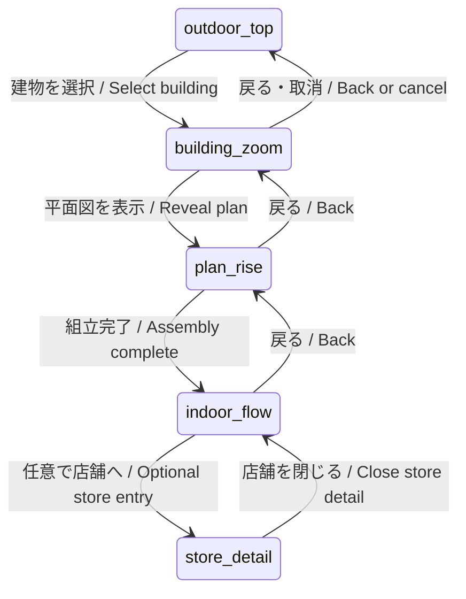

# Phase 2: 架空商業ビルの屋内体験 / Fictional commercial building

## 1. 目的と今回の範囲 / Goal and present scope

真上の渋谷スクランブル俯瞰から、テナントに「ひだまり珈琲」を含む架空商業ビルへズームする。自作の平面図がせり上がって建物になり、屋内の歩行者流、店舗立ち寄り、ポップアップによる動線変化、エスカレーター前広告の到達を **promo モード**で比較する。任意で店内へ入り、座席占有、行列、在庫を見る。以下は今後の設計であり、実測需要・売上・広告効果の予測ではない。

Start directly above Shibuya Scramble, zoom into a fictional commercial building containing **ひだまり珈琲 / Hidamari Coffee**, raise its authored floorplan into a building, and enter it. A future **promo mode** compares indoor flows, tenant visits, popup detours and ad reach near escalators. Optional store detail shows seats, queues and inventory. This is a proposed toy simulation, with assumed demand and behaviour coefficients rather than measured business outcomes.

今回の実装は [indoor.mjs](../web3d/shibuya/indoor.mjs) の JSDoc 型、固定のシーン一覧、既定で無効な設定、空の切替フックと回帰テストのみ。WIP の `app.mjs` にある `window.__setIndoorScene` を引き継ぐ。`requestIndoorScene(target, options)` は `enabled: true` を渡しても必ず `false` を返し、引数も変更しない。描画、カメラ、Worker、乱数、既存設定JSON、既存 promo 表示には接続しない。

This change supplies contracts, a frozen scene list, disabled defaults, an inert transition hook and regression tests. It retains the WIP browser entry point, `window.__setIndoorScene`. Every request returns `false`, even with `enabled: true`, without modifying its arguments. Rendering, cameras, workers, random streams, bundled configuration and the current promo viewer keep their existing behaviour. JSDoc describes a proposed data contract; runtime validation and indoor execution are future work.

```js
// Reserved API: both calls currently return false and leave the scene untouched.
window.__setIndoorScene('building_zoom');
window.__setIndoorScene('indoor_flow', {
  enabled: true, floorplan: authoredPlan, storeDetail: false
});
```

## 2. 視覚的着想とデータの由来 / Visual inspiration and provenance

参考は [指定された投稿](https://x.com/SammmAing/status/2112251300750458983) の、依頼で指定された「スクロールで平面図が家に組み上がる」という表現だけを視覚的着想として挙げる。投稿本文・動画は今回の環境では取得できず、内容の独自確認はしていない。図面、建物形状、画像、動画、コード、寸法、演出素材は一切複製しない。スクロールと押しボタンのどちらでも動く独自の進行制御を設計する。

The [supplied post](https://x.com/SammmAing/status/2112251300750458983) is cited solely for the user-described visual idea of a floorplan assembling into a house while scrolling. Its text/video could not be retrieved here, so that description has not been independently verified. No plans, geometry, images, video, code, dimensions or animation assets are copied. Progress control will be authored independently for scrolling and explicit buttons.

ビル名・テナント・平面図・寸法は本プロジェクトで創作する。実在施設の図面、避難図、BIM、スキャンを使わない。既存の OSM / PLATEAU は屋外の背景として別管理し、屋内図面や実在ビルの内部を推定する入力にしない。下の例は架空の2階建て・各階24×18 mである。既存カフェの目印に入口を合わせる配置はデモ上の接続であり、その場所に実在する建物の内部を表さない。

Building identity, tenants, dimensions and plans are self-authored fiction. No real facility floorplans, evacuation diagrams, BIM or scans are used. Existing OSM / PLATEAU data remain separate outdoor context and do not supply inferred interiors. The example is an invented two-storey building with a 24×18 m footprint per floor. Aligning its cafe entrance with the existing fictional cafe marker is a demo placement, not a claim about any real building at that location.

## 3. シーン遷移と生成 / Scene transitions and generation



| シーン / Scene | 将来の表示・制御 / Planned behaviour |
| --- | --- |
| `outdoor_top` | 交差点の真上。既存 `top` プリセットの座標系を利用するが、起動時の既存 `orbit` は変更しない。/ Direct overhead view using the existing top camera frame; the current orbit startup remains unchanged. |
| `building_zoom` | 架空表示を添えてビルへ滑らかに接近。遷移前のカメラと注視点を保存。/ Label the building fictional, approach smoothly and save the prior camera and target. |
| `plan_rise` | `p∈[0,1]` をスクロール・ボタンで操作。線画→床板→壁の押出し→各階の高さへ配置→屋根の順。/ Scroll or buttons control progress: linework, slabs, wall extrusion, floor placement, roof. |
| `indoor_flow` | 外壁・屋根をカットし、選択階の流れと比較指標を表示。/ Cut away shell/roof and show flows and comparison metrics on the selected floor. |
| `store_detail` | `storeDetail` が真かつ `store_detail` データがある場合のみ。ひだまり珈琲の座席・列・在庫を表示。/ Available only when both the option and store data exist; show Hidamari seats, queue and stock. |

逆方向は同じ進行率を戻す。途中取消で保存したカメラを復元し、データの不正・読込失敗時は屋外に留まる。将来の切替関数は許可された隣接遷移と検証済みデータだけを受理し、未知シーンは拒否する。`prefers-reduced-motion` では組立の中間フレームを省き、キー操作・進む／戻るボタンを提供する。画面の進行率とシミュレーション時刻を分離し、スクロールの往復で人数や訪問を増やさない。

Reverse navigation reverses the same progress. Cancellation restores the saved camera; invalid or missing data leave the viewer outdoors. A future switch accepts only allowed adjacent transitions and validated plans, rejecting unknown scenes. Reduced-motion mode skips intermediate assembly frames; keyboard and next/back controls provide equivalent navigation. Visual progress is separate from simulation time, so scrolling back and forth never creates people or visits.

床の `outline` から床板を三角形分割し、テナント境界から重複辺をまとめて壁を生成する。入口は `entry_node_id` と `entry_width_m` で壁を開口し、concourse の輪郭を障壁にはしない。`elevation_m` と `height_m` で各階を積む。ポップアップは有効なシナリオだけに配置する。`polygon` は来訪者が立てる区画、任意の `fixture_polygon` はその内側の通行不可な什器で、区画全体を障壁にはしない。移動可能領域・壁・表示を同じデータから生成する。エスカレーターとリフトは接続を示す模式形状とし、実施設の構造や設備性能を再現したとは表示しない。

Triangulate floor outlines into slabs, deduplicate tenant boundary segments into walls, and cut entry openings at the declared node and width. Concourse outlines do not become barriers. Stack floors using elevation and height. An active popup's polygon is a walkable visit area within the concourse; its optional inner `fixture_polygon` is a solid obstacle. Inactive popups have no geometry or routing effect. Derive rendering, walls and walkable regions from the same plan. Escalator/lift geometry illustrates connectivity rather than real structural or equipment specifications.

## 4. データスキーマ例 / Example data contract

以下は実行時には読み込まれない設計例。`IndoorFloorplan` と同じフィールドを使う。単位は m、秒、人数/秒。屋外と同じ x東・z南、y上を採用する。`[x,z]` は建物ローカル座標で、屋外座標への変換は `world = origin_world_m + local`、回転なし。階の y は `elevation_m`。ポリゴンは最後の頂点を重複させず閉じる。`floor_id: null` の屋外ノードもローカル座標で記録する。

This is a design example, not a runtime asset. Fields match `IndoorFloorplan`. Units are metres, seconds and people/second; x points east, z south and y up. All `[x,z]` coordinates are building-local, including outdoor nodes with `floor_id: null`. Translate by `origin_world_m` without rotation; floor y comes from elevation. Rings close implicitly, without repeating the first vertex. In this example the cafe entry `[6,6]` maps to the existing fictional marker `[-46,-42]`.

```json
{
  "schema_version": 1,
  "id": "fictional-hidamari-building",
  "provenance": {"kind": "self_authored_fictional", "real_facility_plan": false},
  "units": "m",
  "origin_world_m": [-52, -48],
  "floors": [
    {"id": "f0", "elevation_m": 0, "height_m": 4, "outline": [[0,0],[24,0],[24,18],[0,18]]},
    {"id": "f1", "elevation_m": 4, "height_m": 4, "outline": [[0,0],[24,0],[24,18],[0,18]]}
  ],
  "zones": [
    {"id": "hall0", "floor_id": "f0", "kind": "concourse", "polygon": [[0,0],[24,0],[24,6],[0,6]]},
    {"id": "cafe", "floor_id": "f0", "kind": "tenant", "polygon": [[0,6],[12,6],[12,18],[0,18]]},
    {"id": "goods", "floor_id": "f0", "kind": "tenant", "polygon": [[12,6],[24,6],[24,18],[12,18]]},
    {"id": "popup0", "floor_id": "f0", "kind": "popup", "polygon": [[8,1],[10,1],[10,3],[8,3]], "fixture_polygon": [[8,1],[10,1],[10,1.5],[8,1.5]]},
    {"id": "hall1", "floor_id": "f1", "kind": "concourse", "polygon": [[0,0],[24,0],[24,6],[0,6]]},
    {"id": "books", "floor_id": "f1", "kind": "tenant", "polygon": [[0,6],[24,6],[24,18],[0,18]]}
  ],
  "tenants": [
    {"id": "hidamari", "name": "ひだまり珈琲 / Hidamari Coffee", "zone_id": "cafe", "entry_node_id": "cafe_door", "entry_width_m": 2},
    {"id": "akari", "name": "灯り雑貨 / Akari Goods", "zone_id": "goods", "entry_node_id": "goods_door", "entry_width_m": 2},
    {"id": "sora", "name": "空の本棚 / Sora Books", "zone_id": "books", "entry_node_id": "books_door", "entry_width_m": 2}
  ],
  "navigation": {
    "nodes": [
      {"id": "outside", "floor_id": null, "position_m": [-2,3]},
      {"id": "entry", "floor_id": "f0", "position_m": [0,3]},
      {"id": "hall0_node", "floor_id": "f0", "position_m": [6,3]},
      {"id": "cafe_door", "floor_id": "f0", "position_m": [6,6]},
      {"id": "cafe_inside", "floor_id": "f0", "position_m": [6,9]},
      {"id": "goods_door", "floor_id": "f0", "position_m": [18,6]},
      {"id": "goods_inside", "floor_id": "f0", "position_m": [18,9]},
      {"id": "popup_stop", "floor_id": "f0", "position_m": [9,2]},
      {"id": "up0", "floor_id": "f0", "position_m": [20,3]},
      {"id": "up1", "floor_id": "f1", "position_m": [20,3]},
      {"id": "down0", "floor_id": "f0", "position_m": [22,3]},
      {"id": "down1", "floor_id": "f1", "position_m": [22,3]},
      {"id": "lift0", "floor_id": "f0", "position_m": [23,3]},
      {"id": "lift1", "floor_id": "f1", "position_m": [23,3]},
      {"id": "hall1_node", "floor_id": "f1", "position_m": [6,3]},
      {"id": "books_door", "floor_id": "f1", "position_m": [6,6]},
      {"id": "books_inside", "floor_id": "f1", "position_m": [6,9]}
    ],
    "edges": [
      {"from": "entry", "to": "hall0_node", "width_m": 3, "bidirectional": true},
      {"from": "hall0_node", "to": "cafe_door", "width_m": 2, "bidirectional": true},
      {"from": "cafe_door", "to": "cafe_inside", "width_m": 2, "bidirectional": true},
      {"from": "hall0_node", "to": "goods_door", "width_m": 2, "bidirectional": true},
      {"from": "goods_door", "to": "goods_inside", "width_m": 2, "bidirectional": true},
      {"from": "hall0_node", "to": "popup_stop", "width_m": 1.5, "bidirectional": true},
      {"from": "hall0_node", "to": "up0", "width_m": 3, "bidirectional": true},
      {"from": "hall0_node", "to": "down0", "width_m": 3, "bidirectional": true},
      {"from": "hall0_node", "to": "lift0", "width_m": 3, "bidirectional": true},
      {"from": "hall1_node", "to": "up1", "width_m": 3, "bidirectional": true},
      {"from": "hall1_node", "to": "down1", "width_m": 3, "bidirectional": true},
      {"from": "hall1_node", "to": "lift1", "width_m": 3, "bidirectional": true},
      {"from": "hall1_node", "to": "books_door", "width_m": 2, "bidirectional": true},
      {"from": "books_door", "to": "books_inside", "width_m": 2, "bidirectional": true}
    ]
  },
  "portals": [
    {"id": "entrance0", "kind": "entrance", "from_node": "outside", "to_node": "entry", "width_m": 2.4, "capacity_per_s": 1.2, "travel_s": 1, "bidirectional": true, "accessible": true},
    {"id": "escalator_up", "kind": "escalator", "from_node": "up0", "to_node": "up1", "width_m": 1, "capacity_per_s": 0.6, "travel_s": 10, "bidirectional": false, "accessible": false},
    {"id": "escalator_down", "kind": "escalator", "from_node": "down1", "to_node": "down0", "width_m": 1, "capacity_per_s": 0.6, "travel_s": 10, "bidirectional": false, "accessible": false},
    {"id": "lift", "kind": "lift", "from_node": "lift0", "to_node": "lift1", "width_m": 1.2, "capacity_per_s": 0.2, "travel_s": 16, "bidirectional": true, "accessible": true}
  ],
  "ads": [
    {"id": "escalator_ad", "floor_id": "f0", "position_m": [19,5.5], "heading_deg": 270, "fov_deg": 120, "range_m": 8, "min_exposure_s": 2}
  ],
  "store_detail": {
    "tenant_id": "hidamari",
    "seats": [
      {"id": "s1", "position_m": [3,12]}, {"id": "s2", "position_m": [6,12]},
      {"id": "s3", "position_m": [3,15]}, {"id": "s4", "position_m": [6,15]}
    ],
    "queue": {"capacity": 3, "path_m": [[6,7],[6,8],[6,9]], "service_mean_s": 45},
    "inventory": [
      {"sku": "coffee", "initial_units": 30, "units_per_checkout": 1, "restocks": [{"time_s": 900, "units": 20}]}
    ]
  },
  "experiment": {
    "duration_s": 1800,
    "seeds": [7,17,27,37,47,57,67,77],
    "scenarios": [
      {"id": "none", "active_popup_ids": [], "active_ad_ids": []},
      {"id": "popup_only", "active_popup_ids": ["popup0"], "active_ad_ids": []},
      {"id": "ad_only", "active_popup_ids": [], "active_ad_ids": ["escalator_ad"]},
      {"id": "popup_and_ad", "active_popup_ids": ["popup0"], "active_ad_ids": ["escalator_ad"]}
    ]
  }
}
```

将来のローダーでは、バージョン・由来を検査し、IDの一意性、有限数、単純で面積が正のポリゴン、階内の包含、テナント間の重なり禁止、入口の境界上配置、参照整合性を検証する。高さ・幅・容量・所要時間・表示距離・露出閾値は正、視野角は `(0,360]`、在庫・補充数は非負整数、消費数と列定員は正整数とする。階をまたぐ接続と屋外接続は `portals` のみで表し、通常 `edges` に重複登録しない。無効なポップアップの停止ノードは経路候補から除外する。

The future loader validates version/provenance, unique IDs, finite values, simple positive-area rings, containment, non-overlapping tenants, entries on tenant boundaries and reference integrity. Heights, widths, rates, transit times, ranges and exposure thresholds must be positive; FOV is `(0,360]`. Stock/restocks are nonnegative integers; checkout units and queue capacity are positive integers. Only portals connect floors or outdoors; do not duplicate them in ordinary edges. Disable stop destinations for inactive popups.

全テナントに入口からの往復経路を要求し、段差を避ける個体には `accessible: true` の接続だけで往復できることを確認する。`fixture_polygon` はpopup区画内に限り、停止ノードと歩行経路は什器を避ける。広告はその階の歩行可能領域から見える位置に置く。座席と列は対象テナント内、シナリオの参照先は popup / ad の既存ID、seedは非ゼロの uint32 とする。`store_detail: null` は店内モデルなしを意味する。将来追加する行動係数、経路プロファイル、観測線はバージョン付き設定に分離し、暗黙に現在の屋外係数を流用しない。

Every tenant must be reachable from and back to an entrance, including via accessible portals for agents requiring them. Fixtures belong inside popup polygons; stop nodes and walking routes avoid fixtures. Ads must be visible from walkable space on their floor. Seats/queue points belong inside their tenant; scenarios reference existing popup/ad IDs; seeds are nonzero uint32 values. `store_detail: null` omits the store model. Future behaviour coefficients, routing profiles and measurement gates require versioned configuration rather than silently inheriting outdoor coefficients.

## 5. 歩行・店舗行動と屋外ハンドオフ / Motion, visits and outdoor handoff

既存の [屋外モデル](CALIBRATION.md) は個別エージェント、0.1秒固定刻み、個体別乱数、Worker内の位置・速度・ファネルを持つ。屋内も同じ刻みで個体を積分する。階ごとのグラフで最短所要時間経路を求め、壁までの距離と近傍グリッドを用いる社会力型の局所回避を併用する。混雑ペナルティによる再探索は一定間隔とし、毎tickの経路反転を抑える。狭い入口では進入予約と停止線で流量を制限し、壁抜けを連続区間の衝突判定で防ぐ。近傍数の打切り、重なり、滞留時間を診断値として残す。現行の屋外2.5 mラスタをそのまま細い屋内通路に使わない。

The [existing outdoor model](CALIBRATION.md) uses individual agents, 0.1 s integration, per-agent random state and worker-owned motion/funnel arrays. Indoor agents will use the same fixed step, floor-local shortest-time graph routes and social-force-style local avoidance with wall distances and spatial neighbours. Replan congestion costs at bounded intervals to reduce oscillation. Reservation gates limit narrow doorway flows; swept collision checks prevent crossing walls. Record neighbour truncation, overlaps and excessive dwell as diagnostics. The outdoor 2.5 m obstacle raster is too coarse for the proposed narrow indoor geometry.

行動は通過→店頭検討→入店→滞在→退出。興味・移動負担・待ち時間・施策で次の目的地を選ぶ確率は仮定として設定し、baselineでも自然来店を許す。ポップアップは物理占有と立ち寄り需要の両方を変える。エスカレーターは一方向FIFO待ち、リフトは利用可能者を含む共有FIFO待ちとし、`capacity_per_s × 0.1` を蓄積して整数人を受け入れる（0.6人/秒を毎tick丸めてゼロにしない）。双方向リフト・入口は1つの容量枠を共有し、同時の逆流を直列化する。移送時間中も個体を保持する。

Behaviour progresses through passing, considering, entering, dwelling and leaving. Destination probabilities depend on assumed interests, travel effort, waiting and promotion, while baseline allows organic visits. Popups change both occupied space and attraction. Escalators use directional FIFO queues; lifts use a shared FIFO queue including agents requiring accessible travel. Accumulate fractional capacity per tick before admitting whole people. Bidirectional lifts/entrances share capacity and serialize opposing transfers. Keep identities while they are in transit.

屋外接続は将来の単一Worker内で、各個体の所有者を `outdoor | indoor | transit` のいずれか1つにする。`IndoorHandoff` は `transfer_id, agent_id, portal_id, destination, time_s, random_state, funnel_state, velocity_m_s, resume_node_id` を持つ移譲要求。完全な速度・希望速度・屋外の経路/列車波状態・次の目的地・アクセシビリティ要件はWorkerの個体レジストリに保持し、要求だけで個体全体を再構成しない。移譲はtick末に冪等キーで1度だけ確定し、未確定なら元の所有者のまま待つ。

The future single worker assigns exactly one owner per identity: `outdoor`, `indoor` or `transit`. `IndoorHandoff` describes a request with transfer ID, stable agent ID, portal, destination, simulation time, random state, funnel state, velocity and outdoor resume node. A persistent worker registry retains desired speed, outdoor routing/train-wave state, next destination and accessibility requirements; the request is not a complete serialization of the person. Commit once per idempotency key at the end of a tick; until commitment the source retains ownership and waits.

移譲時は座標を1回だけ変換し、同じ速度・乱数・屋外ファネルを引き継ぐ。帰還先が混雑していれば `transit` に待機させ、到着確認後に屋外へ戻す。横断中の個体は建物へ移さず、クリアランス人数から消さない。屋内と移送中の個体は屋外の近傍探索・横断の再割当・列車波による再配置から除外する。既存のカフェ到達判定は将来の有効モードでだけ入口ハンドオフへ置き換え、現行ファネルの訪問状態と屋内の店舗別訪問台帳を別管理する。

Transform coordinates once per committed transfer and preserve velocity, random state and the outdoor funnel. If an outdoor exit is blocked, retain the person in transit until placement succeeds. Never transfer a pedestrian still crossing or remove them from clearance counts. Exclude indoor/transit owners from outdoor neighbour search, crossing reassignment and train-wave relocation. Only a future enabled indoor mode replaces the current cafe-arrival shortcut with an entrance handoff; keep outdoor funnel state separate from the indoor tenant event ledger.

常に `N_outdoor + N_indoor + N_transit = N_configured`、ID集合は相互排他的とする。建物入口待ちは屋外、階間の待ちは現在階の屋内、移送開始後は `transit` と数える。屋外の `time` を共通のシミュレーション時刻に使い、車両・信号用の `clock` がクリアランスで停止しても屋内の歩行・待ち・広告露出は進む。カメラの切替は所有権を変えない。

Maintain `N_outdoor + N_indoor + N_transit = N_configured` with disjoint ID sets. Entrance queues remain outdoors; vertical queues remain on their current indoor floor; admitted transfers are transit owners. Use outdoor `time` as shared simulation time. Indoor motion, waits and exposure continue when the traffic/signal `clock` pauses for clearance. Camera changes never transfer ownership.

## 6. promo 比較と指標 / Promo comparisons and metrics

`none`, `popup_only`, `ad_only`, `popup_and_ad` の4条件を同じ初期個体・屋外流入・期間・seed集合で独立に実行する。選択中の表示パネル以外も同じtickまで進める。需要・自然来店係数・店内モデルの有無は条件間で固定し、popup / ad の有効IDだけを変える。現行の屋外 promo スイッチの途中切替は対照実験ではなく、既存14日間 promo の倍率付き人数・売上モデルとも集計を混ぜない。屋内は1個体=1人の模擬人数、期間は例では1800秒とする。

Run four independent scenarios from the same initial population, outdoor arrival stream, duration and seed set; advance all panels to the same tick. Hold demand, organic-visit coefficients and store-detail settings fixed, changing only active popup/ad IDs. Toggling current outdoor promotion mid-run is not a controlled comparison. Do not combine indoor counts with the existing 14-day promo model's scaled population or sales summaries. Indoor counts have weight one and use a common 1800 s window in the example.

将来の対応乱数は `(seed, agent_id, tick, event_kind, opportunity_id)` をキーにした値にし、広告接触の追加で他の自然来店抽選がずれないようにする。屋外の逐次乱数状態はハンドオフで保持し、今回その実装を変更しない。比較の初期状態は空の屋内・同一の屋外スナップショットに固定し、ウォームアップなしと明示する。将来ウォームアップを追加する場合は、期間と指標リセットの規則を全条件共通に記録する。

A future paired random scheme keys draws by `(seed, agent_id, tick, event_kind, opportunity_id)` so additional exposure events do not shift unrelated organic choices. Preserve the existing outdoor sequential random state at handoff; this change does not replace it. Start each comparison with empty interiors and an identical outdoor snapshot, explicitly without warm-up. Any later warm-up must use a recorded, common duration and metric-reset rule.

計測窓は `[0,T)`、初期人数0。すべてのイベントをtick確定後に台帳へ記録し、リトライと再描画は再計上しない。指標には単位、母数、観測窓、seedを添える。

Use the window `[0,T)` with zero initial indoor occupants. Record events only after committed ticks, deduplicating retries and rerenders. Every metric carries units, denominator, observation window and seed.

| 指標 / Metric | 定義 / Definition |
| --- | --- |
| 入館数・入館者 / Entries and entrants | 入口で outdoor→indoor の移送が完了したイベント数／ユニークID数。再入館はイベントのみ増える。/ Completed entrance transfers; separately count unique IDs. Reentry adds an event, not a new person. |
| 階占有・通過流量 / Floor occupancy and flow | 各tickの階内人数、時間加重平均、最大。通過は観測線を符号付きで横切る回数/分、床ポリゴン内の表示点数ではない。/ Per-tick floor count, time-weighted mean and maximum; directional crossings of declared gates per minute. |
| 店舗来訪・転換率 / Tenant visits and conversion | 店舗境界を外→内へ横切り、連続5秒滞在して確定。退出後の再入店は新エピソード。ユニーク来訪者 / 同期間のユニーク入館者。未完了は窓末打切り。/ Confirm an entry after 5 continuous seconds inside; reentry after exit is a new episode. Conversion uses unique visitors over unique building entrants; incomplete episodes are censored. |
| ポップアップ到達・迂回 / Popup reach and detour | 区画内に連続3秒いたユニークID。共通の出発地・目的地を完了した個体の経路長差mと所要時間差秒を対照と比較し、到着率と対象人数も表示。/ Unique IDs dwelling inside for 3 s; compare path length/time for paired agents completing the same OD task, alongside completion rate and cohort size. |
| 広告到達・到達率 / Ad reach and reach rate | 下記の視認条件を連続 `min_exposure_s` 満たしたIDを広告ごと・窓ごとに1回。複数広告の全体到達はID和集合。分母は全ユニーク入館者で固定。/ Count an ID once per ad/window after the visibility threshold; union IDs across ads. Rate denominator is all unique building entrants. |
| 露出時間 / Exposure time | 可視tickの秒数を個体・広告ごとに積算。総和は人秒であり人数ではない。施策なし広告到達は0。/ Accumulate visible seconds per person/ad; total is person-seconds. Inactive ads have zero reach. |
| 待ち時間・滞在 / Waiting and dwell | 列へ入ってから受入までの秒数、平均とp95（昇順の `ceil(0.95n)` 番目、完了0件は `null`）。完了数・未完了数・窓末時点の待ち秒数を併記。滞在も退出済みと打切りを分ける。/ Queue-entry to admission, mean/p95 using nearest rank, or null with no completions; report served count, unfinished count and elapsed waits at cutoff. Separate completed and censored dwell. |
| 増分 / Uplift | seedごとの `V_scenario − V_none` を人数で示す。比率は `ΔV/V_none`、基準0なら `null`。/ Paired visit differences per seed; relative uplift is null when baseline is zero. |

広告の可視判定は同一階、距離 `d <= range_m`、表示面の外向き法線 `n=(cos θ,sin θ)` と広告→個体の単位ベクトル `v` で `n·v >= cos(fov_deg/2)`、壁による遮蔽なしをすべて満たすこと。個体の視線が進行方向の前方±60度以内で広告を向く条件も設け、停止中は最後の有効な進行方向を保持する。人同士の遮蔽は初期版では扱わない。条件が切れれば連続露出を0へ戻す。カメラから見えた回数や広告の半径内人数を「到達」とはしない。

Visibility requires the same floor, distance within range, the display's outward normal satisfying `n·v >= cos(fov/2)` for the display-to-person unit vector, and unobstructed wall line of sight. The pedestrian must face the ad within a ±60° gaze proxy around movement heading; while stationary retain the last valid heading. Initial scope omits occlusion by other people. Reset continuous exposure whenever any condition fails. Camera visibility and simple proximity are not ad reach.

8 seedでは対応差の平均と標本標準偏差を計算し、平均差の95%区間を `mean(Δ) ± 2.365 × sd(Δ)/sqrt(8)` とする（自由度7のt区間）。1 seedなら区間は `null`。他のseed数では対応するt分位点を使う。ばらつきはモデル内の乱数差だけを表し、仮定の正しさや実際の施策効果は保証しない。来訪と広告到達は別指標であり、到達した来訪者を全員広告の効果として計上しない。売上・ROIはこの段階の出力に含めない。

For eight seeds report the mean paired difference and a 95% t interval, `mean(Δ) ± 2.365 × sd(Δ)/sqrt(8)` with seven degrees of freedom. One seed yields a null interval; other sample sizes use the corresponding t quantile. This covers simulation randomness, not uncertainty in behavioural assumptions or real effects. Visits and reach remain separate; exposed visitors are not automatically attributed to ads. Revenue and ROI are outside this phase.

## 7. 任意の店内詳細 / Optional store detail

詳細モデルは別の比較セットで全条件とも有効にする。個体の状態は入店→列待ち→注文処理→着席/持帰り→退出。列は有限FIFO、満員時は設定された離脱確率で退出し、通路へ無制限に伸ばさない。サービス時間は例の平均45秒を持つ分布から個体別に生成し、分布・離脱・着席希望・滞在時間の係数は将来の設定で明示する。着席は空席を1席だけ予約し、退出・取消時に解放する。

Enable the detail model consistently across all scenarios in a separate experiment set. States are entry, finite FIFO queue, service, seating/takeaway and exit. A full queue triggers a configured abandonment choice rather than unbounded corridor spill. Draw service durations per person from a declared distribution with the example's 45 s mean. Distribution, abandonment, seating preference and dwell parameters need future explicit configuration. Reserve one free seat per seated person and release it on exit/cancellation.

在庫は注文処理完了時に1回だけ減算し、同tickの補充を先に適用する。不足時は注文失敗として記録し、在庫を負にしない。初期在庫＋補充−提供数×消費数＝残在庫をSKU別に維持する。店舗来訪、注文、提供、着席を別イベントとして扱う。窓末の在席率は占有席/全席、平均在席率は占有席秒/(席数×T)。0席なら比率は `null`。列長の平均・最大、提供完了件数、離脱数、欠品による失敗、未完了注文、在庫推移を併記する。詳細画面を閉じてもモデルは停止・初期化しない。

At service completion decrement inventory once, applying restocks earlier in the same tick. Record insufficient stock as a failed order and never allow negative inventory. Per SKU, preserve initial stock plus restocks minus fulfilled units. Visits, orders, fulfilments and seating are distinct events. Instant seat occupancy is occupied/total seats; time-mean occupancy is occupied seat-seconds divided by seats×T, or null with zero seats. Report mean/max queue length, fulfilments, abandonment, stockout failures, pending orders and stock history. Closing the detail view neither stops nor resets the model.

## 8. テスト計画 / Test plan

| 段階 / Stage | 検証と合格条件 / Checks and acceptance |
| --- | --- |
| 今回 / Current contracts | 文書JSONの構造・参照・幾何の基本整合、両方向とアクセシブル経路、シナリオID。ソースと配布用コピーのAPIで全シーン・未知シーン・有効指定も `false`、引数不変、副作用なし。フック呼出し前後と次tick以降で屋外snapshot・個体乱数が対照と一致。既存エクスポートと全pytestも通す。/ Check example structure, references, basic geometry, return/accessibility routes and scenarios. Both module copies decline every request without effects; outdoor snapshots and random streams match a control before and after subsequent advances. Existing exports and full pytest pass. |
| データと生成 / Data and generation | 自己交差・階外・重複ID・未知参照・無効寸法・実在図面フラグを拒否。扉と壁の開口一致、active popupのみ占有、床数・高さ・メッシュ破棄を検証。/ Reject invalid rings, references, dimensions and provenance; verify doors, active popup geometry, floor placement and disposal. |
| 遷移とUI / Transitions and UI | 全隣接遷移、逆戻り、途中取消、読込失敗、連打、縮小画面、キー操作、動きの低減、店内データなしをブラウザで確認。カメラ操作だけでは時刻・人数・指標が変わらない。/ Browser checks cover forward/back/cancel, failures, repeated actions, small screens, keyboard, reduced motion and missing store data; camera-only actions preserve simulation state. |
| 歩行と移譲 / Motion and handoff | 0人・満員入口・低容量の端数蓄積・一方向接続・リフト往復・階差を検証。二重送信・取消・帰還混雑でも人数保存とID排他。クリアランス停止中も屋内timeが進み、列車波が屋内個体を動かさない。壁抜け・非有限座標を0件とする。/ Test zero population, bottlenecks, fractional capacity, direction and accessible returns; retries and blocked exits conserve identity. Indoor time continues during clearance holds; waves cannot move indoor owners. No wall crossings or nonfinite positions. |
| 指標と比較 / Metrics and comparison | 小さな手計算軌跡で再入店、5秒/3秒閾値、窓境界、広告表裏・階差・遮蔽・2秒連続・中断・重複除外を確認。基準0と1 seedのnull、対応差・区間、途中パネル切替の再現性を検証。/ Hand-calculated traces verify visits, dwell thresholds, window edges, ad front/back/floors/walls, continuous exposure and deduplication; test nulls, paired differences, intervals and panel-independent replay. |
| 店内 / Store | 座席の二重予約0、定員超過0、補充と注文が同tickでも在庫保存、在庫負数0。未完了と離脱を完了に混ぜない。無効時は店内イベント0。/ No double seats, queue overflow or negative stock; preserve inventory on concurrent restock/service and keep unfinished/abandoned events separate. Disabled detail emits no store events. |
| 性能 / Performance | まず総数20,000人のうち屋内所有者を最大1,000人として測る。4比較は独立実行の合計負荷を測り、CPU/GPU・解像度・seed・draw calls・Worker遅延p50/p95・メモリ・FPSを記録。既存値は [性能記録](PERFORMANCE.md) と同条件のみ比較し、未測定FPSを保証しない。/ Benchmark 20,000 total identities with up to 1,000 indoors, then four independent scenarios. Record hardware, resolution, seed, draw calls, worker latency, memory and FPS; compare existing measurements only under matched conditions. |

今回の追加テストは [test_indoor.py](../tests/test_indoor.py)。将来の描画や屋内シミュレーションが実装済みだとは扱わない。検証コマンド: `uv run pytest -q`。現在の物理ソルバのストレス検証は既存pytestから実行される。

Current regression coverage lives in [test_indoor.py](../tests/test_indoor.py); future renderer and indoor solver checks above are acceptance plans, not claimed current coverage. Run `uv run pytest -q`; the existing suite includes the outdoor physical solver stress check.

## 9. マイルストーン / Milestones

| 順序 / Order | 成果物 / Deliverable | 完了条件 / Exit criterion |
| --- | --- | --- |
| M0・今回 / This change | 日英仕様、型、無効設定、空フック、テスト / Bilingual design, contracts, inert hook and tests | 既存挙動を維持し、文書例と全テストが通る。/ Preserve existing behaviour; validate example and pass the full suite. |
| M1 | 自作フロアプランと検証ローダー / Authored plan and validating loader | 出典フラグ、全参照、往復経路、扉・壁の生成を確認。まだ既定で無効。/ Validate provenance, references, return routes and generated openings; keep default disabled. |
| M2 | 真上→ズーム→組立→内部のカメラとカット表示 / Camera sequence, assembly and cutaway | 逆再生・取消・キー操作・動き低減を含むブラウザ受入。/ Accept forward/reverse/cancel, keyboard and reduced-motion flows. |
| M3 | 屋内歩行・店舗立ち寄り・階間接続・屋外移譲 / Indoor motion, visits, portals and handoff | 人数・乱数・ID保存、壁・定員・信号の回帰を通す。/ Pass conservation, identity/random continuity, geometry, capacity and signal regressions. |
| M4 | promo 4条件・ポップアップ動線・広告到達 / Four promo scenarios, popup routing and ad reach | 手計算の指標検証、対応seed比較、区間表示、性能測定。/ Validate trace-derived metrics, paired seeds, intervals and measured performance. |
| M5・任意 / Optional | ひだまり珈琲の座席・行列・在庫 / Hidamari seats, queue and stock | 同一条件での詳細モデル比較、座席・在庫保存、窓末打切り表示。/ Compare matched detail-enabled runs; conserve seats/stock and expose censoring. |

M1以降は別の実装段階。本変更でUIを有効化したり、実在施設データを取得したりはしない。各段階で既定無効のまま受入を完了し、公開方法と有効化は別途決める。

M1 onward are future implementation stages. This change does not activate UI or acquire real facility data. Complete each acceptance gate with the feature disabled by default; release and activation are separate decisions.
